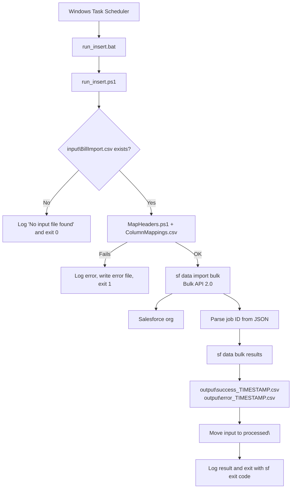

# Salesforce CSV Loader for Windows: Design Document

## 1. Purpose and scope

Loads a CSV file from a Windows machine into a Salesforce object on a schedule. It uses Salesforce CLI (`sf`), PowerShell, Bulk API 2.0 and Windows Task Scheduler. It does not use Data Loader Desktop or a Data Loader JAR.

**In scope**
- One input file per run, loaded into one Salesforce object
- Header renaming through a mapping file
- Row-level success and failure output
- Run log and archived input

**Out of scope / not designed for**
- Real-time or high-volume integration
- Guaranteed once-only delivery
- Multiple objects or multiple files in one run
- Non-comma delimiters

The supplied scripts perform **insert**. Upsert and delete need the edits described in section 9.

## 2. Architecture



## 3. Components

| File | Role | Typically edited? |
|---|---|---|
| `run_insert.bat` | Entry point for Task Scheduler. Starts PowerShell with `-NoProfile -ExecutionPolicy Bypass` and passes the exit code back. | Only if the install path or script name changes |
| `run_insert.ps1` | Orchestrator. Holds the job configuration, runs mapping, runs the Salesforce CLI import, collects results, archives the input and writes the log. | Yes, for the org alias, object and operation |
| `MapHeaders.ps1` | Reads the input CSV, replaces the header row using the mapping file and writes a temporary mapped CSV. | Rarely |
| `ColumnMappings.csv` | Two-column mapping (`SourceColumn`, `SalesforceField`). | Yes, for every new source or object |
| `BillImport_sample.csv`, `BillImport_bulk_sample.csv` | Example inputs showing the expected format. | No (replace with your own test data) |
| `jobs.zip` | Deployment archive containing the files above and the empty working folders. | No |

## 4. Configuration

Set in the configuration block at the top of `run_insert.ps1`:

| Variable | Meaning | Supplied value (example) |
|---|---|---|
| `$orgAlias` | Alias given at `sf org login web --alias` | `dataloader-itreview` |
| `$sfObject` | API name of the target object | `LTA_BillImport__c` |
| `$mappingFile` | Path to the mapping CSV | `C:\Dataloader\jobs\ColumnMappings.csv` |

Set further down in the script (edit these to rename files):

| Variable | Meaning |
|---|---|
| `$inputFile` | Expected input: `C:\Dataloader\jobs\input\BillImport.csv` |
| `$mappedFile` | Temporary mapped CSV in `temp` |
| `$processedFile` | Archive name in `processed` |

All paths are hard-coded to `C:\Dataloader\jobs`. Installing elsewhere means changing every reference in the three scripts.

## 5. Folder layout and file lifecycle

```text
C:\Dataloader\jobs\
  run_insert.bat
  run_insert.ps1
  MapHeaders.ps1
  ColumnMappings.csv
  input\       BillImport.csv                       (placed by operator or source system)
  temp\        BillImport_mapped_TS.csv, sfraw_TS.json
  output\      success_TS.csv, error_TS.csv, runlog.txt
  processed\   BillImport_TS.csv                    (archived input)
```

`TS` is a `yyyyMMdd_HHmmss` timestamp.

| File | Created | Removed |
|---|---|---|
| Mapped CSV (`temp`) | After header mapping | Straight after the `sf` import call |
| `sfraw_TS.json` (`temp`) | From the import's JSON output | After the job ID is parsed |
| Everything in `temp` | n/a | At the start of every run (stale files from an interrupted run) |
| Input file | By the operator | Moved to `processed` at the end of the run |
| `runlog.txt` | First run | Never. It is appended, so manage its size |

## 6. Run flow in detail

1. **Prepare.** Create `temp`, `output` and `processed` if missing. Delete anything in `temp`.
2. **Check input.** If `input\BillImport.csv` is absent, log "No input file found - skipping job" and exit 0.
3. **Map headers.** Run `MapHeaders.ps1` in a child PowerShell. It:
   - reads the file as bytes and removes a UTF-8 BOM if present,
   - splits the content into lines and takes the first line as the header,
   - loads `ColumnMappings.csv` into a lookup,
   - splits the header on commas, trims whitespace and quotes for the lookup, and replaces mapped names,
   - leaves unmapped headers unchanged,
   - writes the result as UTF-8 without a BOM, with CRLF line endings.
4. **Import.** Run `sf data import bulk --sobject $sfObject --file <mapped> --target-org $orgAlias --wait 10 --json` and save the JSON output. Record the CLI exit code. Delete the mapped file.
5. **Find the job ID.** Parse the JSON and read `result.jobId`, `result.id` or `data.jobId`.
6. **Fetch row results.** If a job ID exists, run `sf data bulk results --job-id <id> --target-org $orgAlias` from `C:\Dataloader\jobs`. The CLI writes `<jobId>-success-records.csv` and `<jobId>-failed-records.csv` there. The script renames them to `output\success_TS.csv

## 7. Customer benefits

### Business value
- **Automates recurring loads.** A file that arrives on a schedule is loaded without someone running Data Loader by hand. This removes a repetitive manual task and the errors that come with it.
- **No extra licences or middleware.** It uses Salesforce CLI, PowerShell and Windows Task Scheduler. These are free or already on the Windows host, so there is nothing to buy or host.
- **Quick to start.** Extract the package, authorize the org, set the object and mappings, and schedule it. A first load can run the same day, and there is no development project.
- **Reusable across objects and orgs.** The org alias, object and mappings are settings. The same package works for another object, or another org, without code changes.
- **Auditable.** Every run writes a timestamped log, row-level success and failure files, and an archived copy of the input. Teams can reconcile what was loaded and prove it.
- **Easier to correct.** The failure file lists each rejected row with its Salesforce error, so the customer can fix the data and reload only those rows.

### Technical and security value
- **Modern authentication.** It uses OAuth through `sf org login web`. It does not use SOAP API `login()`, which Salesforce is retiring, and it stores no passwords, security tokens or access tokens in scripts.
- **Built on supported tooling.** Salesforce CLI and Bulk API 2.0 are current Salesforce tools, so the approach does not depend on the legacy Data Loader client.
- **Least privilege.** A dedicated integration user needs only the object and field permissions the job uses (Create for insert, Edit for upsert, Delete for delete).
- **Handles file-sized volumes.** Bulk API 2.0 processes records in batches on the Salesforce side, which suits loads that are too large to do through the UI.
- **Simple to maintain.** There are four small files and one mapping CSV. Anyone who can read PowerShell can follow and adjust it.
- **Flexible operation.** Insert is supplied, and the README documents the edits for upsert and delete.

### Typical use cases
- A nightly or weekly export from a legacy or on-premises system that must reach Salesforce.
- Data migration waves that load the same file format repeatedly.
- Proof-of-concept integrations where middleware is not yet justified.
- Customers whose security teams want to move off SOAP username-and-password logins.

### When another approach fits better
- Near real-time or event-driven integration (use platform events, APIs or middleware).
- Very large or business-critical pipelines that need retries, alerting and guaranteed delivery.
- Sources that are not CSV files, or loads that touch several objects at once.
